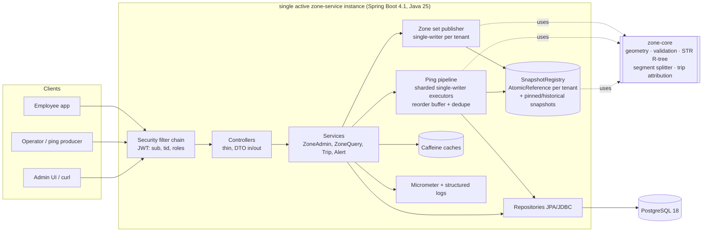
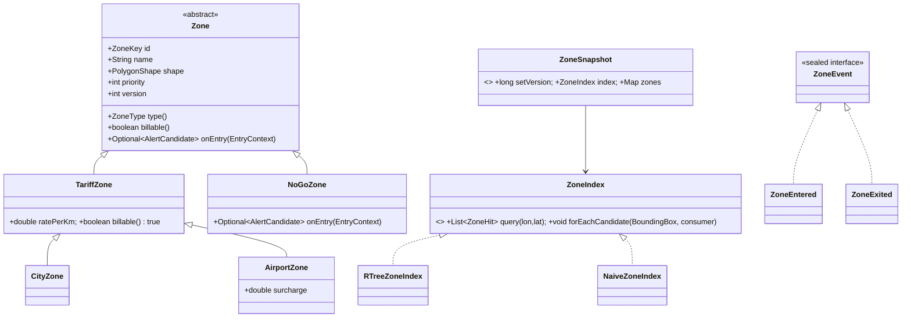

# 03 — Architecture, Data Model, API

## 1. Component view



## 2. Package layout (base package `com.polyzones`)

### `zone-core` (no frameworks)
```
com.polyzones.core
├── geo/        LonLat (record), BoundingBox, GeometryTolerance, Haversine, LocalPlane (optional helpers), Location (enum)
├── shape/      Ring, PolygonShape (immutable, normalised, bbox, edge arrays), EdgeBandIndex, PolygonValidator, ValidationIssue/ValidationResult, SegmentIntersector, SweepSelfIntersectionDetector
├── zone/       Zone (abstract), TariffZone, CityZone, AirportZone, NoGoZone, ZoneType, ZoneKey (record), NightWindow, ZoneVersionRef
├── index/      ZoneIndex (interface), RTreeZoneIndex (STR), NaiveZoneIndex, ZoneHit, ZoneSnapshot (immutable), SnapshotBuilder
├── trip/       Ping, TripState, TripAttributor (incremental), SegmentSplitter, ZoneMembershipTracker, ReorderBuffer, ZoneEvent (sealed: ZoneEntered, ZoneExited), AlertCandidate, DistanceLedger, RoundingAllocator
└── util/       Preconditions, DeterministicIds (UUIDv5)
```

### `zone-service`
```
com.polyzones.service
├── ZoneServiceApplication
├── config/        SecurityConfig, CacheConfig, MetricsConfig, ClockConfig, PipelineProperties (@ConfigurationProperties), JacksonConfig (JsonMapper), ResilienceConfig
├── security/      JwtTokenService, TenantContext, CurrentPrincipal, RoleNames
├── web/           AuthController, ZoneAdminController, ZoneQueryController, TripController, AlertController, dto/*, ApiExceptionHandler (ProblemDetail)
├── application/   ZoneAdminService, ZoneQueryService, TripService, AlertService, AuthService   (@Transactional boundaries)
├── publish/       ZoneSetPublisher, SnapshotRegistry, PinnedSnapshotRegistry, SnapshotLoader, PublishStatus
├── pipeline/      PingIngestService, ShardedTripExecutor, TripProcessor, TripCheckpointer, BackpressureGuard
├── persistence/   entity/*, repository/* (Spring Data JPA) , JdbcCheckpointRepository, GeometryCodec (GeoJSON text <-> PolygonShape)
├── observability/ PipelineMetrics, LogSanitizer, MdcFilter
└── admin/         DemoDataSeeder (profile `demo` only)
```

## 3. Class design for OOP (P4)


- **Encapsulation:** immutable records/classes, factories (`PolygonShape.of(...)` validates), no public setters.
- **Inheritance + polymorphism:** `Zone` hierarchy; `onEntry` overridden by `NoGoZone` (night rule) and no-op elsewhere; `ZoneIndex` implementations interchangeable (R-tree vs naive) in tests and benchmarks.
- **Layering rule (ArchUnit-enforced):** `web` → `application` → (`persistence`, `publish`, `pipeline`) → `zone-core`. `web` may not touch `persistence`; `zone-core` may not depend on anything outside the JDK.

## 4. Database schema (Flyway migrations `zone-service/src/main/resources/db/migration`)

Naming: `V1__tenants_users.sql`, `V2__zones.sql`, `V3__trips.sql`, `V4__events_alerts.sql`, `V5__indexes.sql`.

```sql
-- V1
create table tenants (
  id uuid primary key,
  name text not null unique,
  timezone text not null default 'Asia/Kolkata',
  night_start time not null default '22:00',
  night_end   time not null default '06:00',
  created_at timestamptz not null default now()
);
create table app_users (
  id uuid primary key,
  tenant_id uuid not null references tenants(id),
  username text not null,
  password_hash text not null,
  role text not null check (role in ('EMPLOYEE','ADMIN','OPERATOR')),
  enabled boolean not null default true,
  created_at timestamptz not null default now(),
  unique (tenant_id, id),
  unique (tenant_id, username)
);

-- V2
create table zone_set_versions (
  tenant_id uuid not null references tenants(id),
  version bigint not null,
  status text not null check (status in ('BUILDING','PUBLISHED','FAILED')),
  created_by uuid,
  created_at timestamptz not null default now(),
  published_at timestamptz,
  primary key (tenant_id, version),
  foreign key (tenant_id, created_by) references app_users (tenant_id, id),
  check ((status = 'PUBLISHED') = (published_at is not null))
);
create table zones (
  tenant_id uuid not null references tenants(id),
  zone_id uuid not null,
  created_at timestamptz not null default now(),
  primary key (tenant_id, zone_id)
);
create table zone_versions (
  tenant_id uuid not null,
  zone_id uuid not null,
  version int not null,
  set_version bigint not null,
  name text not null,
  zone_type text not null check (zone_type in ('CITY','AIRPORT','TARIFF','NO_GO')),
  priority int not null default 0,
  rate_per_km numeric(12,4),
  surcharge numeric(12,2),
  geometry_geojson text,           -- null for tombstones
  vertex_count int not null default 0,
  min_lon double precision, min_lat double precision, max_lon double precision, max_lat double precision,
  content_hash text,
  deleted boolean not null default false,
  created_by uuid,
  created_at timestamptz not null default now(),
  primary key (tenant_id, zone_id, version),
  unique (tenant_id, zone_id, set_version),
  unique (tenant_id, zone_id, version, set_version),
  foreign key (tenant_id, zone_id) references zones (tenant_id, zone_id),
  foreign key (tenant_id, set_version) references zone_set_versions (tenant_id, version),
  foreign key (tenant_id, created_by) references app_users (tenant_id, id),
  check (version > 0),
  check (vertex_count >= 0),
  check (deleted or (geometry_geojson is not null and content_hash is not null
      and min_lon is not null and min_lat is not null and max_lon is not null and max_lat is not null
      and min_lon <= max_lon and min_lat <= max_lat)),
  check (not deleted or geometry_geojson is null)
);
create index zone_versions_by_set on zone_versions (tenant_id, set_version);
create index zone_versions_latest on zone_versions (tenant_id, zone_id, set_version desc);

-- V3
create table trips (
  tenant_id uuid not null references tenants(id),
  trip_id uuid not null,
  employee_id uuid not null,                 -- JWT sub of the employee, opaque
  pinned_set_version bigint not null,
  status text not null check (status in ('IN_PROGRESS','COMPLETED','ABORTED')),
  started_at timestamptz not null,
  completed_at timestamptz,
  processed_seq bigint not null default -1,
  durable_acked_seq bigint not null default -1,
  checkpoint jsonb,                          -- written via JdbcClient with ?::jsonb
  checkpoint_at timestamptz,
  unzoned_meters double precision not null default 0,
  next_transition_ordinal bigint not null default 0,
  primary key (tenant_id, trip_id),
  unique (tenant_id, trip_id, pinned_set_version),
  foreign key (tenant_id, employee_id) references app_users (tenant_id, id),
  foreign key (tenant_id, pinned_set_version) references zone_set_versions (tenant_id, version),
  check (processed_seq >= -1),
  check (durable_acked_seq >= -1 and durable_acked_seq <= processed_seq),
  check (unzoned_meters >= 0),
  check (next_transition_ordinal >= 0)
);
create table trip_zone_distance (
  tenant_id uuid not null, trip_id uuid not null,
  zone_id uuid not null,
  zone_version int not null,
  zone_version_set_version bigint not null,
  pinned_set_version bigint not null,
  meters double precision not null,
  primary key (tenant_id, trip_id, zone_id),
  foreign key (tenant_id, trip_id, pinned_set_version)
    references trips (tenant_id, trip_id, pinned_set_version),
  foreign key (tenant_id, zone_id, zone_version, zone_version_set_version)
    references zone_versions (tenant_id, zone_id, version, set_version),
  check (meters >= 0)
);

-- V4
create table zone_events (
  event_id uuid not null,
  tenant_id uuid not null, trip_id uuid not null, zone_id uuid not null,
  zone_version int not null, zone_version_set_version bigint not null,
  evaluated_set_version bigint not null,
  transition_ordinal bigint not null,
  kind text not null check (kind in ('ENTER','EXIT')),
  event_time timestamptz not null,
  dwell_seconds double precision,            -- on EXIT
  reason text not null default 'CROSSING',   -- CROSSING | TRIP_START | TRIP_END | ZONE_CHANGED
  primary key (tenant_id, event_id),
  unique (tenant_id, trip_id, transition_ordinal),
  unique (tenant_id, event_id, trip_id, zone_id, zone_version, zone_version_set_version, evaluated_set_version),
  foreign key (tenant_id, trip_id) references trips (tenant_id, trip_id),
  foreign key (tenant_id, zone_id, zone_version, zone_version_set_version)
    references zone_versions (tenant_id, zone_id, version, set_version),
  foreign key (tenant_id, evaluated_set_version)
    references zone_set_versions (tenant_id, version),
  check (transition_ordinal >= 0),
  check (dwell_seconds is null or dwell_seconds >= 0)
);
create table alerts (
  alert_id uuid not null,
  tenant_id uuid not null, trip_id uuid not null, zone_id uuid not null,
  source_event_id uuid not null,
  kind text not null check (kind in ('NO_GO_NIGHT_ENTRY')),
  severity text not null,
  event_time timestamptz not null,
  zone_version int not null, zone_version_set_version bigint not null,
  evaluated_set_version bigint not null,
  created_at timestamptz not null default now(),
  acknowledged boolean not null default false,
  primary key (tenant_id, alert_id),
  unique (tenant_id, source_event_id, kind),
  foreign key (tenant_id, trip_id) references trips (tenant_id, trip_id),
  foreign key (tenant_id, zone_id, zone_version, zone_version_set_version)
    references zone_versions (tenant_id, zone_id, version, set_version),
  foreign key (tenant_id, evaluated_set_version)
    references zone_set_versions (tenant_id, version),
  foreign key (tenant_id, source_event_id, trip_id, zone_id, zone_version,
      zone_version_set_version, evaluated_set_version)
    references zone_events (tenant_id, event_id, trip_id, zone_id, zone_version,
      zone_version_set_version, evaluated_set_version)
);
create index zone_events_trip on zone_events (tenant_id, trip_id, event_time);
create index alerts_tenant_time on alerts (tenant_id, event_time desc);
```
Every tenant-owned FK is composite and includes `tenant_id`; application queries still include the tenant predicate. The `app_users.id` UUID remains a primary key, with `(tenant_id,id)` unique specifically for tenant-safe FKs. `trip_zone_distance` stores only billable zone rows; `UNZONED` is the separate `trips.unzoned_meters` bucket, so no string sentinel bypasses the zone FK. Rows record the owning set version of the referenced zone version separately from the trip's pinned or event's evaluated set: a zone may be unchanged across later sets, especially for live NO_GO evaluation. Event/alert IDs are tenant-scoped composite keys and their FKs prove that the trip, exact zone version, and evaluated set belong to the same tenant. Add indexes for each FK's referencing columns in the migration. Application validation must also prove that a billing distance's zone version is present in the trip's pinned composition; the scalar FKs alone cannot enforce this temporal composition rule.

Row-level security (defence in depth, SHOULD): `alter table ... enable row level security` with policy `tenant_id = current_setting('app.tenant_id')::uuid`, set per transaction. If implemented, still keep explicit `tenantId` parameters. `created_by` is nullable for system-created records; when non-null it uses a composite `(tenant_id, created_by)` FK.

**Published composition:** historical loaders select only zone-version rows joined to a `PUBLISHED` `zone_set_versions` row with `set_version ≤ requested N`; the latest row per `(tenant_id, zone_id)` wins, then tombstones are removed. Candidate publication loading may include exactly its own `BUILDING` target set plus earlier `PUBLISHED` sets; no other `BUILDING`/`FAILED` set is eligible. A requested `asOfSetVersion` itself must be `PUBLISHED`.

## 5. REST API (all under `/api/v1`, JSON, errors as RFC 9457 `ProblemDetail`)

| Method & path | Roles | Purpose |
|---|---|---|
| `POST /auth/login` | public | username+password(+tenant name) → short-lived access JWT (claims: `sub`, `tid`, `roles`) |
| `POST /zones/validate` | ADMIN | dry-run polygon validation; returns all issues |
| `POST /zones` | ADMIN | create zone → zone v1 → new zone-set version; returns after atomic swap (`201`) |
| `PUT /zones/{zoneId}` | ADMIN | new zone version (+ new set version) |
| `DELETE /zones/{zoneId}` | ADMIN | tombstone version (+ new set version) |
| `GET /zones` `?setVersion=` | ADMIN, OPERATOR, EMPLOYEE | list zones of the latest (or given) set; pagination |
| `GET /zones/{zoneId}` `?version=` | same | one zone (latest or specific version) |
| `GET /zones/{zoneId}/versions` | ADMIN, OPERATOR | version history |
| `GET /zone-sets` | ADMIN, OPERATOR | set versions with status and timing |
| `POST /zones/query` | ADMIN, OPERATOR | `{lat, lon, asOfSetVersion?}` → all containing zones + `billingZoneId` + `setVersion` used |
| `POST /zones/query/batch` | ADMIN, OPERATOR | up to 1,000 points, single snapshot read for the whole batch |
| `POST /trips` | OPERATOR, ADMIN | start trip `{tripId?, employeeId, startTime}` → validates employee in JWT tenant and pins current set version; authorization for an operator to select another employee is an open policy item in `CHANGELOG.md` |
| `POST /trips/{tripId}/pings` | OPERATOR | batch of pings (≤ 500); per-item result `ACCEPTED/DUPLICATE/REJECTED(reason)`; `ACCEPTED` means admitted to bounded in-memory processing; returns `durableAckedSeq` (committed checkpoint frontier only); `429` + `Retry-After` on backpressure |
| `POST /trips/{tripId}/complete` | OPERATOR | finalises: closes open memberships (TRIP_END), writes final distances |
| `GET /trips/{tripId}` | OPERATOR, ADMIN, EMPLOYEE(own) | status, pinned version |
| `GET /trips/{tripId}/attribution` | same | km by zone (rounded with largest-remainder), UNZONED, total, method + version metadata |
| `GET /trips/{tripId}/events` | same | ENTER/EXIT with dwell |
| `GET /alerts` `?tripId=&from=&to=` | ADMIN, OPERATOR | alerts |
| `POST /alerts/{id}/ack` | OPERATOR, ADMIN | acknowledge |
| `GET /actuator/health/{liveness,readiness}` | public | readiness is UP only after all tenant snapshots are loaded on this one active instance |
| `GET /actuator/prometheus` | internal management port 8081 | metrics |

Error code catalogue (stable `code` field in ProblemDetail properties): `POLYGON_NOT_CLOSED`, `POLYGON_SELF_INTERSECTS`, `HOLE_OUTSIDE_OUTER`, `HOLES_OVERLAP`, `POLYGON_TOO_LARGE`, `INVALID_COORDINATE`, `ANTIMERIDIAN_UNSUPPORTED`, `ZONE_NOT_FOUND`, `TRIP_NOT_FOUND`, `TRIP_COMPLETED`, `VERSION_NOT_FOUND`, `PING_REJECTED_*`, `BACKPRESSURE`, `PUBLISH_FAILED`, `UNAUTHENTICATED`, `FORBIDDEN`, `VALIDATION_FAILED`, `INTERNAL_ERROR`. Every error has a `correlationId`; none contains stack traces, SQL, or other tenants' data.

## 6. Hardest flow — sequence diagram (put in `docs/design-note.md`)

"Admin shrinks a no-go zone at 9:00 PM while a trip that started at 8:50 PM is in progress, queries keep flowing."

```mermaid
sequenceDiagram
  autonumber
  participant Op as Operator (pings)
  participant API as Controllers
  participant Pipe as TripProcessor (shard)
  participant Reg as SnapshotRegistry (AtomicReference)
  participant Adm as Admin
  participant Pub as ZoneSetPublisher (single writer/tenant)
  participant DB as PostgreSQL

  Note over Pipe,Reg: One active service instance. 8:50 PM trip T starts → pins set version V (billing)
  Op->>API: POST /trips/T/pings
  API->>Pipe: enqueue (ordered by seq)
  Pipe->>Reg: pinned(V) for billing, latest() for no-go
  Adm->>API: PUT /zones/{noGo} (shrink)
  API->>Pub: submit edit
  Pub->>DB: tx1 lock tenant, allocate V+1, insert zone_version + BUILDING set
  Pub->>Pub: build candidate from published sets + this BUILDING set off the request path
  Note over Op,Reg: pings keep reading snapshot V (no blocking, no half-built state)
  Pub->>DB: tx2 mark V+1 PUBLISHED (commit = durable truth)
  Pub->>Reg: atomic swap latest := V+1
  Pub->>API: invalidate/version-scope caches, metrics, return 201
  Op->>API: POST /trips/T/pings (after swap)
  Pipe->>Reg: billing → pinned V (unchanged); no-go → latest V+1 (new shape)
  alt build fails
    Pub->>DB: mark FAILED
    Note over Reg: latest stays V; error returned; counter incremented
  end
```

## 7. Failure-mode seed table (extend in the design note)

| What fails | What the caller sees | How the system recovers |
|---|---|---|
| Index build throws during an edit | `500 PUBLISH_FAILED` ProblemDetail; zone set marked FAILED | Old snapshot keeps serving; `index_swap_failures_total` ↑; admin retries |
| Service crashes mid-trip | Pings fail/time out; previously returned `durableAckedSeq` remains the recovery frontier | Restart loads the atomic checkpoint; client resumes from `durableAckedSeq+1`; accepted but uncommitted pings are replayed |
| Crash between tx2 commit and swap | brief unavailability | Startup loads latest PUBLISHED set → consistent |
| Duplicate pings | `DUPLICATE` per item | Idempotent by `(tenant,trip,seq)` |
| Out-of-order pings | `ACCEPTED` (buffered) or `REJECTED(late)` | Reorder buffer; late counted and not applied |
| DB slow/unavailable on checkpoint | Pings may be `ACCEPTED` in memory while `durableAckedSeq` stays unchanged; readiness degrades | Retry the captured checkpoint snapshot; apply backpressure at the bounded unpersisted backlog; after recovery commit state and ack atomically |
| Queue full | `429 BACKPRESSURE` + `Retry-After` | Producer retries; `ping_queue_depth` gauge |
| Request timeout | `503/504` ProblemDetail | Safe to retry (idempotent) |
| Cross-tenant id access | `404` | n/a |

## 8. Transaction and publication boundaries

- Never hold a database transaction open while validating expensive geometry, building an index, or waiting in a publisher lane. `tx1` allocates and persists one `BUILDING` candidate atomically; candidate construction is outside a transaction; `tx2` publishes it; a separate short `tx3` marks it `FAILED` only when publication did not commit. A committed `PUBLISHED` row is never rolled back in the registry by changing its status.
- The per-tenant publisher lane is held from version allocation through build, `PUBLISHED` commit, and local pointer swap. Every latest query captures one `ZoneSnapshot` reference. Start-trip pins the single snapshot it captured; each ping captures the latest snapshot once for its NO_GO work.
- Checkpoint persistence is one transaction per captured trip-state frontier: exact checkpoint JSON/sequence metadata, cumulative zone and unzoned totals, events, alerts, and `durable_acked_seq`. It is safe to retry the same captured snapshot. Checkpoint writes for a trip are serialized; updates with an older frontier cannot overwrite newer state. No transaction spans asynchronous in-memory processing.
- `@Transactional` boundaries live in application-owned transaction services. The publisher and checkpointer orchestrate these short operations; snapshot builds and shard queue waits occur outside them.
- The target set is included by a dedicated candidate loader (published predecessors plus that one BUILDING set). Normal historical loading only sees PUBLISHED rows. No-op edits still create the required zone and set versions; identical content may reuse immutable geometry/index structures only if the resulting snapshot carries the new set version.
- This sequence assumes one active application instance. A second active instance can publish a committed version without atomically updating other registries; it is unsupported by D-20.
