# Polygon Zones at Scale
## Tariff Zones, No-Go Areas & Trip Attribution

A versioned geographic zone engine for mobility platforms, designed to manage tariff zones, restricted areas, GPS streams, and trip-level distance attribution.

**Advanced Track | MoveInSync Backend Case Study 2026**

---

# Table of Contents

1. [Introduction](#1-introduction)
2. [Problem Statement](#2-problem-statement)
3. [Requirements](#3-requirements)
4. [Features](#4-features)
5. [System Architecture](#5-system-architecture)
6. [Polygon Zone Management](#6-polygon-zone-management)
7. [Geometry Engine](#7-geometry-engine)
8. [Spatial Indexing](#8-spatial-indexing)
9. [Trip Attribution](#9-trip-attribution)
10. [Live Zone Updates and Versioning](#10-live-zone-updates-and-versioning)
11. [Security and Multi-Tenancy](#11-security-and-multi-tenancy)
12. [Resilience and Failure Handling](#12-resilience-and-failure-handling)
13. [Caching and Observability](#13-caching-and-observability)
14. [Database Design](#14-database-design)
15. [REST API](#15-rest-api)
16. [Technology Stack](#16-technology-stack)
17. [Performance Benchmarks](#17-performance-benchmarks)
18. [Geographic Accuracy](#18-geographic-accuracy)
19. [Testing and Verification](#19-testing-and-verification)
20. [Installation and Setup](#20-installation-and-setup)
21. [Running the Demo](#21-running-the-demo)
22. [Postman API Testing](#22-postman-api-testing)
23. [Design Decisions and Trade-offs](#23-design-decisions-and-trade-offs)
24. [Failure Mode Analysis](#24-failure-mode-analysis)
25. [Deployment Architecture](#25-deployment-architecture)
26. [Project Structure](#26-project-structure)
27. [Limitations and Future Improvements](#27-limitations-and-future-improvements)

---

# 1. Introduction

Modern mobility platforms operate across multiple geographic regions containing different tariff zones, restricted areas, and operational boundaries.

A single vehicle trip may cross several geographic zones. The platform must accurately determine which zones a vehicle enters, calculate the distance travelled within each zone, and maintain consistent attribution even when administrators modify zone boundaries during an ongoing trip.

This project implements a polygon-based geographic zone management and trip-attribution system.

The application provides:

- Administrative management of geographic zones.
- Polygon validation and geometry processing.
- Efficient spatial queries using an STR-packed R-tree.
- Geographic distance calculation.
- GPS stream processing.
- Segment splitting at polygon boundaries.
- Zone entry and exit event generation.
- Immutable zone-set versioning.
- Atomic spatial snapshot publication.
- Trip-level zone-version pinning.
- JWT authentication and role-based authorization.
- Tenant isolation.
- Durable processing checkpoints.
- Caching, monitoring, and failure handling.

The system is implemented using Java 25 and Spring Boot, with a separate geometry engine that remains independent of the application framework.

# 2. Problem Statement

The objective is to design and implement a backend system capable of managing thousands of geographic polygons while processing continuous GPS updates.

The system must answer the following questions:

1. Which geographic zones contain a particular GPS coordinate?
2. Is a coordinate inside, outside, or exactly on a polygon boundary?
3. How much distance has a vehicle travelled inside each tariff zone?
4. At what point does a vehicle enter or leave a restricted area?
5. What happens when an administrator edits a polygon while trips are in progress?
6. How can GPS events be processed without incorrectly processing duplicates?
7. How should late, invalid, and out-of-order GPS events be handled?
8. How can geographic queries remain efficient when thousands of polygons exist?
9. How can tenant data remain isolated?
10. How can the system recover from processing or persistence failures?

The architecture focuses on correctness, consistency, efficient spatial querying, and reproducible trip attribution.

# 3. Requirements

## 3.1 Polygon Model

- Support non-convex polygons.
- Support polygons containing holes.
- Support polygons with thousands of vertices.
- Reject unclosed polygon rings.
- Reject self-intersecting polygons.
- Reject holes outside their outer polygon.
- Define explicit edge and vertex classification rules.
- Create a new version for every successful zone edit.
- Preserve historical zone versions.

## 3.2 Point Queries

- Determine whether a coordinate belongs to a polygon.
- Correctly handle non-convex polygons.
- Correctly handle polygon holes.
- Handle edge and vertex cases explicitly.
- Avoid brute-force evaluation of every polygon for every GPS ping.
- Support spatial queries against large polygon datasets.

## 3.3 Trip Attribution

- Process ordered GPS coordinates.
- Split GPS segments at polygon boundaries.
- Calculate distance inside each tariff zone.
- Generate ENTER and EXIT events.
- Handle duplicate and out-of-order pings.
- Maintain durable processing checkpoints.
- Preserve the zone version associated with each trip.

## 3.4 Live Zone Editing

- Allow administrators to edit zones.
- Validate new geometry before publication.
- Build updated spatial indexes in the background.
- Publish completed snapshots atomically.
- Prevent readers from observing partially built indexes.
- Preserve the pinned version of ongoing trips.

## 3.5 Advanced Track Requirements

- Automated verification of hard requirements.
- Concurrency and failure testing.
- Performance benchmarks.
- Time and space complexity analysis.
- Architecture and sequence diagrams.
- Failure-mode documentation.
- One-command Docker deployment.
- Reproducible demonstration.

# 4. Features

| Feature | Implementation |
|---|---|
| Polygon validation | Custom Java geometry engine |
| Non-convex polygons | Supported |
| Polygon holes | Supported |
| Boundary classification | Boundary treated as inside |
| Spatial indexing | Immutable STR-packed R-tree |
| Spatial snapshots | Immutable snapshot publication |
| Zone versioning | Versioned zone sets |
| Trip version pinning | Pinned zone-set version per trip |
| Segment splitting | Boundary intersection processing |
| Distance attribution | Haversine-based segment calculation |
| Trip events | Deterministic ENTER and EXIT events |
| GPS processing | Duplicate, late, and invalid ping handling |
| Durable checkpoints | Persisted processing progress |
| Authentication | JWT |
| Authorization | ADMIN, OPERATOR, EMPLOYEE |
| Multi-tenancy | Tenant-scoped resource access |
| Caching | Caffeine |
| Monitoring | Spring Boot Actuator and Micrometer |
| Persistence | PostgreSQL and Flyway |
| Deployment | Docker Compose |

# 5. System Architecture

The application follows a layered architecture with a clear separation between the geometry engine and the Spring Boot service.

## 5.1 High-Level Architecture

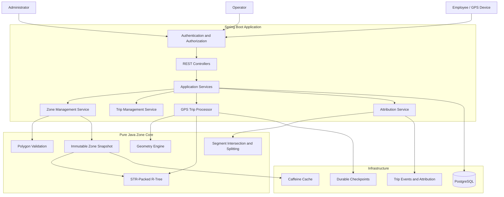

## 5.2 Architectural Layers

| Layer | Responsibility |
|---|---|
| API Layer | REST endpoints and request validation |
| Security Layer | Authentication, authorization, and tenant context |
| Application Layer | Zone, trip, and attribution workflows |
| Domain Layer | Business rules and domain models |
| Geometry Core | Polygon validation and geometric operations |
| Spatial Index | Efficient candidate polygon retrieval |
| Persistence Layer | Database access and transactions |
| Infrastructure Layer | Caching, metrics, and container deployment |

## 5.3 Geometry Core Separation

The `zone-core` module is independent of Spring Boot.

It contains geometry and spatial indexing functionality without depending on:

- Spring application context.
- REST controllers.
- Database repositories.
- HTTP request handling.

This makes the core engine independently testable and reusable.

# 6. Polygon Zone Management

Administrators can define geographic zones using ordered polygon coordinates.

A zone contains:

- Zone identifier.
- Tenant identifier.
- Zone name.
- Zone type.
- Priority.
- Polygon geometry.
- Version information.

## 6.1 Polygon Structure

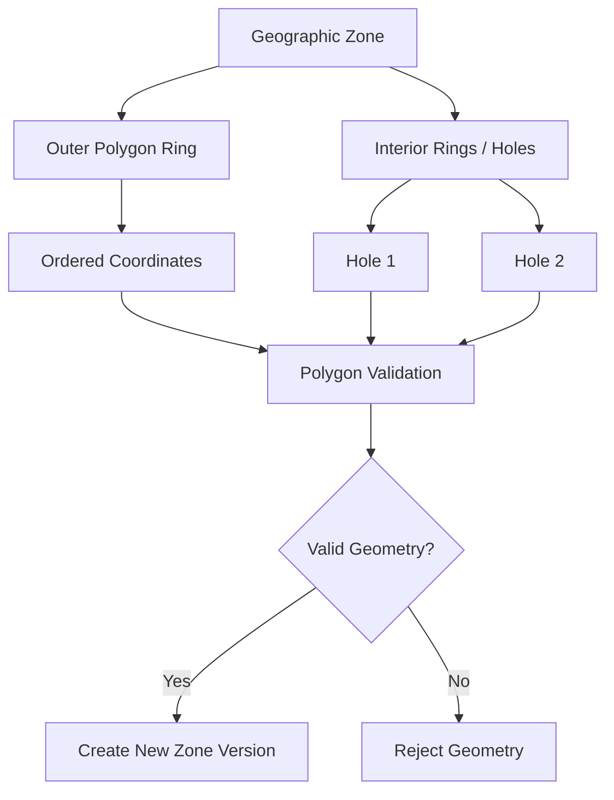

## 6.2 Polygon Validation

The geometry engine validates polygon definitions before they are accepted.

Validation includes:

1. Ring closure.
2. Minimum coordinate requirements.
3. Self-intersection detection.
4. Outer-ring validation.
5. Interior-hole containment.
6. Ring relationship validation.
7. Numerical tolerance handling.

Invalid polygon geometry is rejected rather than being published into the active spatial index.

## 6.3 Boundary Semantics

The system explicitly defines polygon boundary behavior.

A point on an edge or vertex is classified as:

`BOUNDARY`

For zone membership, the boundary is treated as inside.

This provides predictable behavior when GPS coordinates fall directly on geographic boundaries.

# 7. Geometry Engine

The geometry engine performs the mathematical operations required by zone management and trip attribution.

Its responsibilities include:

- Polygon validation.
- Point-in-polygon classification.
- Boundary detection.
- Segment intersection.
- Segment splitting.
- Geographic distance calculations.

## 7.1 Point-in-Polygon Classification

A point can have one of three classifications:

| Classification | Meaning |
|---|---|
| INSIDE | Point is within the polygon |
| OUTSIDE | Point is outside the polygon |
| BOUNDARY | Point lies on an edge or vertex |

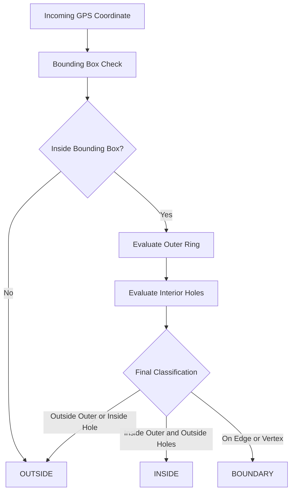

## 7.2 Geographic Distance Calculation

Latitude and longitude are angular coordinates, not ordinary Cartesian coordinates.

The system uses the Haversine formula to calculate great-circle distance between geographic coordinates.

The Haversine calculation is used in trip distance attribution.

Segment interpolation and intersection calculations are separately subject to approximation, as described in the geographic accuracy section.

## 7.3 Numerical Tolerances

The implementation uses explicit tolerances:

| Parameter | Value |
|---|---:|
| Boundary epsilon | `1e-9` degrees |
| Segment parameter epsilon | `1e-12` |

These tolerances help maintain stable classification and intersection behavior near polygon boundaries.

# 8. Spatial Indexing

A naive spatial-query implementation would test every GPS coordinate against every polygon.

For thousands of polygons and a continuous stream of GPS pings, this approach is inefficient.

The project uses an immutable STR-packed R-tree.

## 8.1 Why an STR-Packed R-Tree?

An STR-packed R-tree organizes polygon bounding boxes hierarchically.

Instead of checking every polygon, the index first retrieves a smaller set of candidate polygons.

The geometry engine then performs exact polygon classification on those candidates.

## 8.2 Spatial Query Flow

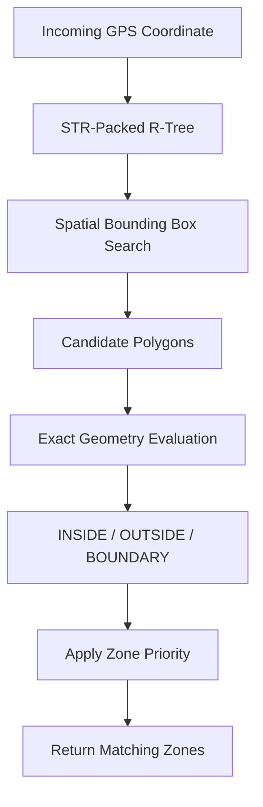

## 8.3 Query Complexity

Let:

- `N` represent the number of polygons.
- `V` represent the average number of vertices per polygon.
- `K` represent the number of candidate polygons returned by the index.

A naive query can require approximately:

`O(N × V)`

With spatial indexing, the conceptual query cost becomes:

`O(log N + K × V)`

Actual performance depends on spatial distribution, overlap, index structure, and the number of candidates returned.

## 8.4 Index Construction

The spatial index is built from immutable zone geometry.

The application constructs a complete replacement index before publishing it.

Readers continue using the existing snapshot until the replacement is ready.

This avoids exposing partially built index structures.

# 9. Trip Attribution

Trip attribution calculates the distance travelled inside each tariff zone.

A trip consists of an ordered sequence of GPS pings.

Each GPS ping contains:

- Trip identifier.
- Sequence number.
- Latitude.
- Longitude.
- Event timestamp.

The system processes consecutive GPS coordinates as line segments.

## 9.1 Trip Processing Pipeline

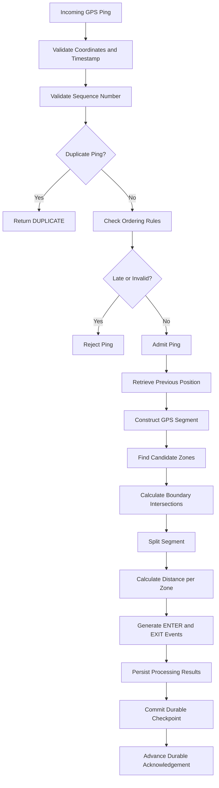

## 9.2 Segment Splitting

A GPS segment can cross one or more polygon boundaries.

The system calculates boundary intersections and splits the segment into smaller portions.

Each resulting portion is classified independently.

Example:

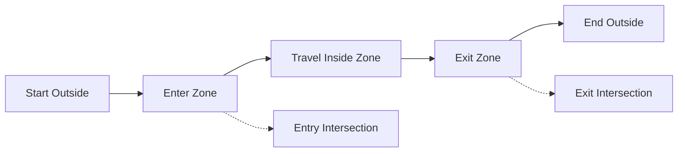

This allows the system to attribute only the relevant portion of a GPS segment to each tariff zone.

## 9.3 Distance Attribution

For each split segment:

1. Determine its geographic distance.
2. Identify its applicable zone classification.
3. Attribute the distance to the relevant zone.
4. Generate boundary transition events.
5. Persist the attribution result.

## 9.4 Trip Events

The system generates deterministic events:

- `ENTER`
- `EXIT`

These events maintain trip, zone, timestamp, and version context.

Deterministic event generation supports reproducible processing and verification.

## 9.5 Example Attribution

Example output from the demonstration:

| Zone | Attributed Distance |
|---|---:|
| City | 16.707 km |
| Airport | 2.784 km |
| **Total** | **19.491 km** |

Attribution method:

`HAVERSINE_SEGMENT_SPLIT`

# 10. Live Zone Updates and Versioning

Administrators may edit geographic boundaries while trips are in progress.

The system uses immutable zone-set versions to ensure that ongoing trips retain consistent attribution rules.

Every successful zone edit creates a new version.

Historical versions remain available.

## 10.1 Zone Publication Workflow

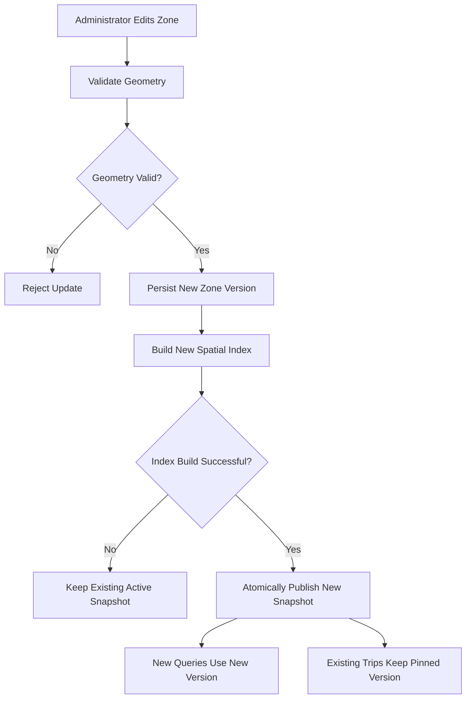

## 10.2 Atomic Snapshot Publication

The publication workflow:

1. Validate edited geometry.
2. Persist the new zone version.
3. Build a replacement immutable spatial index.
4. Publish the completed snapshot atomically.
5. Route new queries to the newly published version.
6. Preserve existing trip snapshots.

Readers never observe a partially constructed spatial index.

## 10.3 Trip Version Pinning

When a trip starts, the application associates it with a specific zone-set version.

The trip continues using that version until completion.

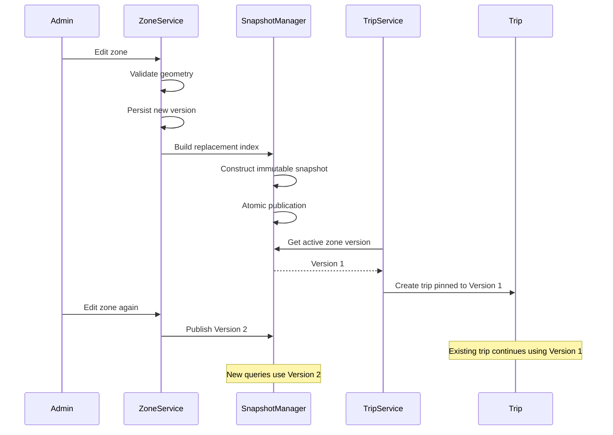

This prevents administrative edits from silently changing the rules applied to an ongoing trip.

# 11. Security and Multi-Tenancy

The application uses JWT-based authentication and role-based authorization.

## 11.1 Roles

| Role | Responsibility |
|---|---|
| ADMIN | Administrative zone and system operations |
| OPERATOR | Trip creation and trip management |
| EMPLOYEE | Permitted employee and trip operations |

## 11.2 Authentication Flow

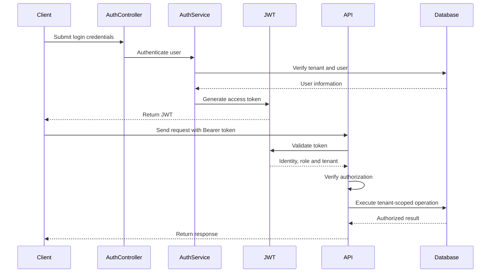

## 11.3 Tenant Isolation

Every tenant has its own logical data boundary.

Authenticated tenant context is used when accessing tenant-owned resources.

A tenant cannot access another tenant's trips or zones.

Cross-tenant access to an existing resource returns a non-disclosing `404 NOT_FOUND` response where applicable.

## 11.4 Security Controls

- JWT authentication.
- Role-based access control.
- Tenant-scoped resource access.
- Cross-tenant isolation.
- Protected management endpoints.
- Login throttling.
- Non-disclosing error responses.
- Avoidance of sensitive employee information in logs.

# 12. Resilience and Failure Handling

GPS processing must remain correct when events are duplicated, delayed, invalid, or interrupted by infrastructure failures.

## 12.1 GPS Event Handling

| Scenario | Expected Behavior |
|---|---|
| Duplicate ping | Do not process again |
| Late ping | Reject according to ordering rules |
| Invalid coordinates | Reject the ping |
| Clock-skewed timestamp | Reject the ping |
| Out-of-order sequence | Apply sequence validation |
| Worker failure | Preserve durable checkpoint consistency |
| Database failure | Do not acknowledge uncommitted processing |

## 12.2 Durable Checkpoints

The application distinguishes between ping admission and durable processing.

An accepted ping does not automatically mean that it has been durably processed.

The durable acknowledgement advances only after the required processing and persistence operations succeed.

This ensures that the application does not report work as durably processed before the corresponding data has been committed.

## 12.3 Failure Recovery Flow

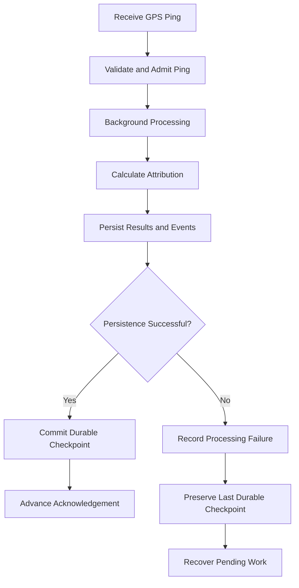

## 12.4 Single-Instance Protection

The supported deployment topology is single-instance.

The application acquires a PostgreSQL session-level advisory lock before reporting readiness.

The lock is retained for the lifetime of the process.

If another application instance attempts to acquire the lock, startup fails.

If the lock connection is lost, the application:

1. Marks itself unready.
2. Stops processing work.
3. Fails closed.
4. Terminates instead of silently reconnecting and resuming.

This is a deliberate consistency decision, not a distributed fencing implementation.

# 13. Caching and Observability

## 13.1 Snapshot Caching

The application uses Caffeine to cache historical immutable zone snapshots.

Cache characteristics:

- Tenant and zone-set version keys.
- W-TinyLFU eviction.
- Maximum weight budget.
- Vertex-count-based weighing.
- Immutable snapshot values.

Active trip snapshots are retained separately while their trips remain active, so historical cache eviction does not remove the snapshot pinned by an ongoing trip.

## 13.2 Login Throttling

Login throttling uses a Caffeine-backed cache.

The reported configuration includes:

- Five failed attempts.
- A five-minute sliding window.
- Expiration after access.
- Maximum cache size of 100,000 entries.

Requests exceeding the configured threshold are rejected with HTTP `429`.

## 13.3 Metrics

| Metric | Description |
|---|---|
| `ping_processing_lag_seconds` | GPS processing lag |
| `ping_worker_failure_total` | GPS worker failures |
| `checkpoint_failures_total` | Checkpoint failures |
| `ping_rejected_total` | Rejected GPS pings |
| `retry_total` | Processing retries |
| `ping_queue_depth` | Pending GPS work |

Rejection reasons include:

- `late`
- `invalid`
- `clock_skew`

## 13.4 Health Monitoring

Management endpoints are exposed on the management server.

Health check:

```bash
curl http://localhost:8081/actuator/health
```

A protected management endpoint may return `401 UNAUTHENTICATED` when accessed without an authorized token. This is expected behavior.

# 14. Database Design

PostgreSQL is used for durable application data.

The persistence layer manages:

- Tenants.
- Users.
- Roles.
- Zones.
- Zone-set versions.
- Trips.
- GPS pings.
- Trip events.
- Attribution results.
- Processing checkpoints.

## 14.1 Logical Entity Relationships

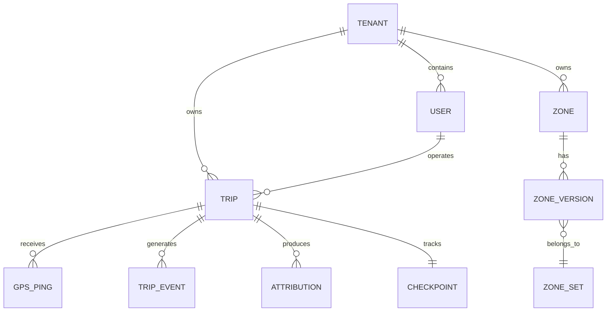

This is a conceptual relationship diagram. Actual table names, foreign keys, and constraints are defined by the database migrations.

## 14.2 Persistence Guarantees

- Tenant-aware ownership.
- Durable trip records.
- Version-aware attribution.
- Persisted GPS processing progress.
- Transactional persistence operations.
- Flyway-managed schema migrations.

# 15. REST API

The application exposes REST APIs under:

`/api/v1`

## 15.1 Authentication

| Method | Endpoint | Description |
|---|---|---|
| POST | `/api/v1/auth/login` | Authenticate and obtain JWT |

Example:

```bash
curl -X POST http://localhost:8080/api/v1/auth/login \
  -H "Content-Type: application/json" \
  -d '{
    "tenant": "acme",
    "username": "admin",
    "password": "YOUR_DEMO_PASSWORD"
  }'
```

Use the returned JWT as a Bearer token.

## 15.2 Zone APIs

| Method | Endpoint | Description |
|---|---|---|
| POST | `/api/v1/zones/validate` | Validate polygon geometry |
| POST | `/api/v1/zones/query` | Query zones containing a coordinate |

Example:

```bash
curl -X POST http://localhost:8080/api/v1/zones/query \
  -H "Authorization: Bearer YOUR_ADMIN_TOKEN" \
  -H "Content-Type: application/json" \
  -d '{
    "lon": 77.55,
    "lat": 12.93
  }'
```

Example response:

```json
{
  "setVersion": 1,
  "zones": [
    {
      "name": "AIRPORT",
      "priority": 20,
      "location": "BOUNDARY"
    },
    {
      "name": "CITY",
      "priority": 10,
      "location": "INSIDE"
    }
  ]
}
```

## 15.3 Trip APIs

| Method | Endpoint | Description |
|---|---|---|
| POST | `/api/v1/trips` | Create a trip |
| POST | `/api/v1/trips/{tripId}/pings` | Submit GPS pings |
| POST | `/api/v1/trips/{tripId}/complete` | Complete a trip |
| GET | `/api/v1/trips/{tripId}/attribution` | Retrieve trip attribution |

### Create a Trip

```bash
curl -X POST http://localhost:8080/api/v1/trips \
  -H "Authorization: Bearer YOUR_OPERATOR_TOKEN" \
  -H "Content-Type: application/json" \
  -d '{
    "employeeId": "YOUR_EMPLOYEE_UUID",
    "startTime": "2026-10-31T11:00:00Z"
  }'
```

The response includes:

- Trip ID.
- Employee ID.
- Pinned zone-set version.
- Trip status.
- Start timestamp.
- Durable acknowledgement.

### Submit GPS Pings

```bash
curl -X POST http://localhost:8080/api/v1/trips/YOUR_TRIP_ID/pings \
  -H "Authorization: Bearer YOUR_OPERATOR_TOKEN" \
  -H "Content-Type: application/json" \
  -d '{
    "items": [
      {
        "seq": 0,
        "lat": 12.93,
        "lon": 77.55,
        "timestamp": "2026-10-31T11:00:05Z"
      },
      {
        "seq": 1,
        "lat": 12.94,
        "lon": 77.56,
        "timestamp": "2026-10-31T11:05:00Z"
      }
    ]
  }'
```

Use timestamps compatible with the application's clock-skew validation rules.

### Complete a Trip

```bash
curl -X POST http://localhost:8080/api/v1/trips/YOUR_TRIP_ID/complete \
  -H "Authorization: Bearer YOUR_OPERATOR_TOKEN"
```

### Retrieve Trip Attribution

```bash
curl http://localhost:8080/api/v1/trips/YOUR_TRIP_ID/attribution \
  -H "Authorization: Bearer YOUR_OPERATOR_TOKEN"
```

The response contains per-zone distance attribution and trip event information.

# 16. Technology Stack

| Category | Technology |
|---|---|
| Programming Language | Java 25 |
| Backend Framework | Spring Boot 4.1.2 |
| Build System | Maven |
| Database | PostgreSQL 18 |
| Database Migration | Flyway |
| Geometry Engine | Custom Java implementation |
| Spatial Index | Immutable STR-packed R-tree |
| Authentication | JWT |
| Authorization | Spring Security |
| Cache | Caffeine |
| Monitoring | Spring Boot Actuator |
| Metrics | Micrometer |
| Testing | JUnit and Spring Boot Test |
| Integration Testing | Testcontainers |
| Benchmarking | JMH |
| Containerization | Docker |
| Orchestration | Docker Compose |

# 17. Performance Benchmarks

The spatial index has been benchmarked independently of HTTP request processing and durable GPS ingestion.

## 17.1 Spatial Query Throughput

| Polygon Vertices | Query Throughput |
|---:|---:|
| 16 | 8,091,255 queries/sec |
| 500 | 2,923,697 queries/sec |

## 17.2 Index Construction

| Measurement | Result |
|---|---:|
| Index build time | 2.679 ms |

## 17.3 Memory Measurements

The following measurements were reported for the tested datasets.

| Dataset | Retained Heap |
|---|---:|
| 1,000 polygons × 16 vertices | 1.64 MB |
| 5,000 polygons × 16 vertices | 6.94 MB |
| 20,000 polygons × 16 vertices | 23.29 MB |
| 100,000 polygons × 16 vertices | 116.90 MB |
| 5,000 polygons × 500 vertices | 115.38 MB |

## 17.4 Query Allocation

| Query Implementation | Allocation |
|---|---:|
| `forEachContaining` | 0.00077 B/op |
| List-returning query API | Approximately 98.6 B/op |

Retained heap and allocation per operation are different measurements and should not be compared as equivalent quantities.

## 17.5 Benchmark Environment

| Property | Value |
|---|---|
| Processor | Apple M2 |
| CPU cores | 8 |
| Memory | 16 GB |
| Operating System | macOS 26.5.1 |
| JVM | OpenJDK 25.0.2 |

## 17.6 Benchmark Scope

The reported throughput measures in-process spatial containment operations.

It does not represent:

- HTTP request throughput.
- PostgreSQL transaction throughput.
- Full GPS ingestion throughput.
- Durable checkpoint throughput.
- End-to-end trip-attribution throughput.

The results should not be presented as proof of production capacity at 50,000 GPS pings per second.

# 18. Geographic Accuracy

GPS coordinates are geographic coordinates, so distance calculations require an appropriate geographic model.

## 18.1 Distance Evaluation

The reported geographic evaluation contains:

| Measurement | Result |
|---|---:|
| Maximum Haversine relative error | 0.561% |
| Maximum degree-interpolation midpoint deviation | 383.9 m |
| Evaluated test coordinates | 36 |

The results are specific to the tested coordinate set and evaluation methodology.

They are not universal error bounds for every route or geographic region.

## 18.2 Geographic Considerations

The implementation distinguishes between:

- Geographic distance calculation.
- Segment interpolation.
- Polygon boundary intersection.
- Point-in-polygon classification.

Using Haversine distance does not by itself make segment interpolation or polygon intersection geodesically exact.

The approximation characteristics are documented separately in the benchmark and design documentation.

# 19. Testing and Verification

The project includes automated tests across the geometry engine, spatial index, application services, persistence layer, and security implementation.

## 19.1 Test Categories

| Category | Verification |
|---|---|
| Polygon validation | Valid and invalid geometry |
| Non-convex geometry | Point classification |
| Polygon holes | Interior exclusion |
| Boundary handling | Edge and vertex cases |
| Segment intersection | Boundary crossing |
| Spatial indexing | Comparison with naive oracle |
| Snapshot publication | Concurrent readers and rebuilds |
| Versioning | Historical version preservation |
| Trip attribution | Distance and event generation |
| GPS processing | Duplicate and late ping handling |
| Checkpoints | Durable acknowledgement |
| Authentication | JWT validation |
| Authorization | Role-based restrictions |
| Tenant isolation | Cross-tenant resource access |
| Persistence | PostgreSQL integration |
| Resilience | Failure handling and recovery |

## 19.2 Latest Reported Test Results

| Test Group | Tests |
|---|---:|
| Core tests | 62 |
| Service unit and slice tests | 58 |
| PostgreSQL Testcontainers tests | 13 |
| **Total** | **133** |

Reported result:

- Passed: 133
- Failed: 0
- Skipped: 0

These figures come from the latest recorded verification report and should be regenerated against the current repository before a new release.

## 19.3 Snapshot Concurrency Test

The latest reported concurrency test used:

- 16 reader threads.
- 200 rebuild and publication operations.
- Concurrent reads during snapshot replacement.

The report recorded zero torn snapshots and zero version regressions.

# 20. Installation and Setup

## 20.1 Prerequisites

Install:

- Java 25.
- Docker Desktop.
- Docker Compose.
- Git.

Verify Java:

```bash
java -version
```

Verify Docker:

```bash
docker --version
docker compose version
```

## 20.2 Clone the Repository

```bash
git clone YOUR_GITHUB_REPOSITORY_URL
cd YOUR_REPOSITORY_NAME
```

## 20.3 Start the Application

Build and start the application and database:

```bash
docker compose up --build
```

## 20.4 Check Running Containers

```bash
docker compose ps
```

## 20.5 Check Application Health

```bash
curl http://localhost:8081/actuator/health
```

Expected response:

```json
{
  "status": "UP"
}
```

## 20.6 Application Endpoints

| Service | Address |
|---|---|
| REST API | `http://localhost:8080` |
| Management Server | `http://localhost:8081` |
| Health Endpoint | `http://localhost:8081/actuator/health` |

## 20.7 Stop the Application

```bash
docker compose down
```

To remove the local database volume as well:

```bash
docker compose down -v
```

**Warning:** Removing volumes deletes the local database data.

# 21. Running the Demo

The project includes an automated demonstration script.

Run:

```bash
./scripts/demo.sh
```

The demonstration exercises the primary application workflow.

## 21.1 Demo Workflow

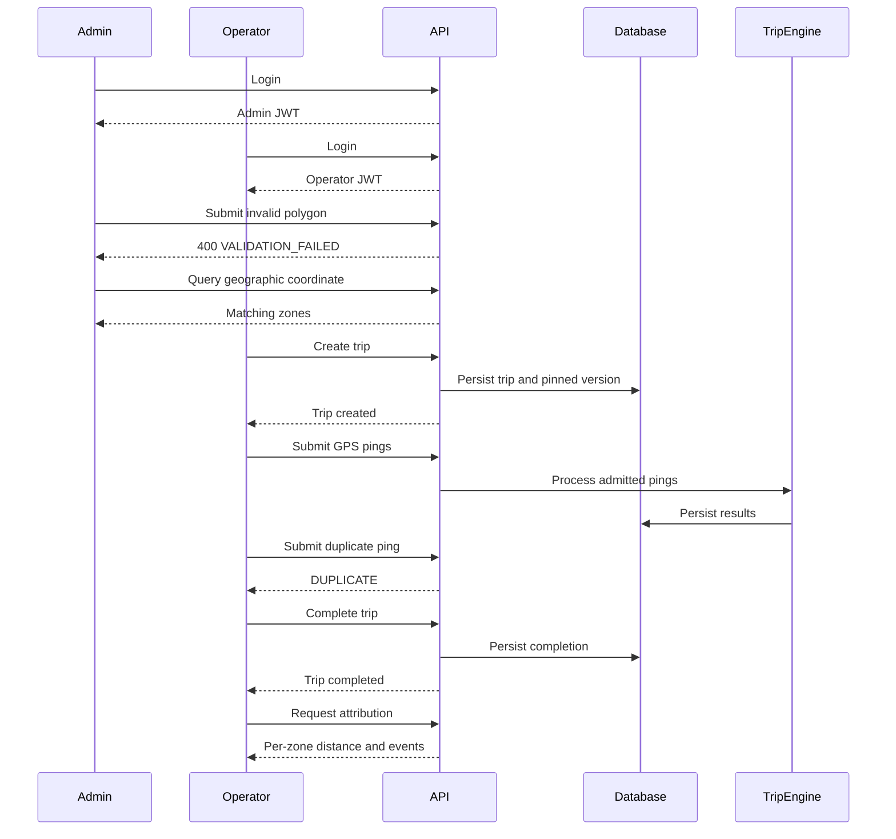

## 21.2 Demonstrated Scenarios

The latest reported demo successfully exercised:

1. Admin login.
2. Operator login.
3. Employee token acquisition.
4. Invalid polygon rejection.
5. Geographic point query.
6. Trip creation.
7. Zone-version pinning.
8. GPS ping submission.
9. Duplicate ping detection.
10. Trip completion.
11. Durable checkpoint reporting.
12. Per-zone distance attribution.
13. Entry and exit events.
14. Cross-tenant access rejection.

## 21.3 Example Demo Result

| Zone | Distance |
|---|---:|
| City | 16.707 km |
| Airport | 2.784 km |
| **Total** | **19.491 km** |

Attribution method:

`HAVERSINE_SEGMENT_SPLIT`

## 21.4 Cross-Tenant Verification

A request made using a Globex operator token to access an Acme trip returned:

`404 TRIP_NOT_FOUND`

This demonstrates the non-disclosing tenant-isolation behavior in the demo.

# 22. Postman API Testing

The REST API can also be tested interactively using Postman.

Recommended collection:

```text
MoveInSync
│
├── Authentication
│   ├── Admin Login
│   ├── Operator Login
│   └── Employee Login
│
├── Zones
│   ├── Validate Polygon
│   └── Query Point
│
├── Trips
│   ├── Create Trip
│   ├── Submit GPS Pings
│   ├── Complete Trip
│   └── Get Attribution
│
└── Security
    └── Cross-Tenant Access
```

Recommended environment variables:

| Variable | Purpose |
|---|---|
| `base_url` | Application URL |
| `admin_token` | Administrator JWT |
| `operator_token` | Operator JWT |
| `employee_token` | Employee JWT |
| `trip_id` | Created trip identifier |

Use Bearer Token authorization for protected requests.

# 23. Design Decisions and Trade-offs

## 23.1 Pure Java Geometry Core

**Decision:** Keep geometry processing independent of Spring Boot.

**Benefits:**

- Independent testing.
- Reduced framework coupling.
- Reusable geometry operations.
- Clear separation of responsibilities.

**Trade-off:** Application integration requires explicit interfaces between the core and service modules.

## 23.2 STR-Packed R-Tree

**Decision:** Use a packed spatial index instead of brute-force polygon scanning.

**Benefits:**

- Reduces the candidate polygon set.
- Supports immutable index structures.
- Enables efficient snapshot replacement.

**Trade-off:** Performance depends on spatial distribution and polygon overlap.

## 23.3 Immutable Zone Versions

**Decision:** Every successful edit creates a new version.

**Benefits:**

- Historical reproducibility.
- Stable trip attribution.
- No in-place mutation of active geometry.

**Trade-off:** Historical versions require storage and cache lifecycle management.

## 23.4 Atomic Snapshot Publication

**Decision:** Construct a complete replacement index before publishing it.

**Benefits:**

- Readers never observe partial index state.
- Existing readers can continue using the old immutable snapshot.
- Publication is atomic.

**Trade-off:** Rebuilding requires temporary additional memory.

## 23.5 Trip Version Pinning

**Decision:** Pin the zone-set version when a trip starts.

**Benefits:**

- Consistent attribution.
- Reproducible historical results.
- Administrative changes do not silently modify ongoing trips.

**Trade-off:** An active trip does not automatically adopt newly published zone boundaries.

## 23.6 Geographic Distance

**Decision:** Use Haversine distance for geographic distance calculations.

**Benefits:**

- Accounts for the Earth's curvature.
- Avoids treating latitude and longitude as ordinary Cartesian coordinates.

**Trade-off:** Segment interpolation and polygon intersection still involve approximation.

## 23.7 Single-Instance Deployment

**Decision:** Use a PostgreSQL session-level advisory lock to enforce a single active application instance.

**Benefits:**

- Explicit consistency model.
- Prevents concurrent application instances from operating against conflicting local state.

**Trade-off:** Does not provide horizontal scaling or distributed fencing.

## 23.8 Tenant Isolation

**Decision:** Enforce tenant context throughout application operations.

**Benefits:**

- Prevents cross-tenant resource access.
- Keeps authorization close to application and persistence boundaries.

**Trade-off:** Tenant context must be propagated consistently.

# 24. Failure Mode Analysis

| Failure | User or System Impact | Handling |
|---|---|---|
| Invalid polygon | Zone cannot be published | Return validation error |
| Self-intersecting polygon | Geometry is invalid | Reject polygon |
| Hole outside outer ring | Invalid polygon relationship | Reject polygon |
| Duplicate GPS ping | Repeated event could corrupt attribution | Detect duplicate |
| Late GPS ping | Historical ordering may be inconsistent | Reject according to ordering rules |
| Invalid GPS coordinate | Incorrect geometry result | Reject ping |
| Clock-skewed ping | Timestamp ordering becomes unreliable | Reject ping |
| Index rebuild failure | New version cannot be activated | Keep previous snapshot |
| Concurrent snapshot publication | Readers may observe inconsistent state without protection | Publish immutable snapshot atomically |
| Database failure | Results may not be durable | Preserve last durable checkpoint |
| Worker failure | Processing may stop | Record failure and recover pending work |
| Cross-tenant request | Unauthorized data access | Return non-disclosing response |
| Application lock loss | Single-instance guarantee is no longer assured | Fail closed and terminate |
| Cache eviction | Historical snapshot may leave cache | Reload immutable version when required |

# 25. Deployment Architecture

The local deployment uses Docker Compose to run the application and PostgreSQL.

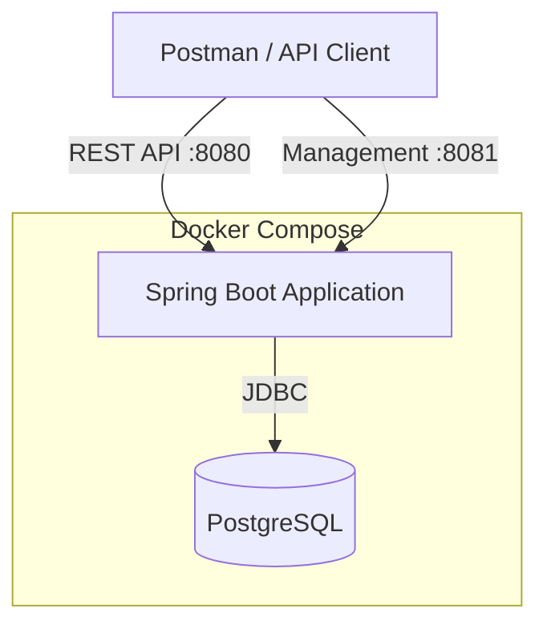

## 25.1 Deployment Characteristics

- Containerized Spring Boot application.
- PostgreSQL database.
- Database migrations through Flyway.
- Application health monitoring.
- Management endpoints.
- Single-instance advisory-lock protection.

## 25.2 Deployment Scope

The current deployment is designed for a reproducible single-instance environment.

Horizontal scaling and distributed worker coordination are not claimed as implemented capabilities.

# 26. Project Structure

```text
.
├── zone-core/
│   └── src/
│       ├── main/
│       │   └── java/
│       │       └── ...
│       └── test/
│           └── java/
│               └── ...
│
├── zone-service/
│   └── src/
│       ├── main/
│       │   ├── java/
│       │   │   └── ...
│       │   └── resources/
│       │       ├── application.yml
│       │       └── db/
│       │           └── migration/
│       └── test/
│           └── java/
│               └── ...
│
├── zone-bench/
│   └── ...
│
├── docs/
│   ├── design-note.md
│   ├── tradeoffs.md
│   ├── DEMO-GUIDE.md
│   ├── IMPLEMENTATION-LOG.md
│   ├── DECISIONS-DEVIATIONS.md
│   └── benchmarks/
│       └── distance-error.csv
│
├── scripts/
│   └── demo.sh
│
├── Dockerfile
├── docker-compose.yml
├── pom.xml
└── README.md
```

# 27. Limitations and Future Improvements

## 27.1 Current Limitations

1. The supported deployment topology is single-instance.
2. The spatial-query benchmark is not an end-to-end GPS ingestion benchmark.
3. Geographic interpolation and segment splitting have approximation error.
4. The implementation uses a custom Java geometry engine rather than delegating all geometry operations to PostGIS.
5. Historical zone snapshots and active trip snapshots have different cache lifecycle rules.
6. An ongoing trip retains its pinned zone-set version after a new version is published.
7. Benchmark results depend on the machine and dataset used.

## 27.2 Potential Future Improvements

- Distributed snapshot publication and fencing.
- Horizontal scaling of GPS ingestion workers.
- Message-broker-based ingestion.
- End-to-end load testing at 50,000 GPS pings per second.
- More extensive geographic accuracy evaluation.
- Advanced polygon simplification.
- Distributed cache invalidation.
- Operational dashboards and alerting.
- Additional failure-injection scenarios.

These are potential extensions and are not claims about currently implemented functionality.

---

# Conclusion

Polygon Zones at Scale provides a versioned geographic zone engine for mobility and location-aware applications.

It combines validated polygon geometry, immutable spatial indexing, trip-level zone versioning, GPS segment splitting, geographic distance attribution, tenant-aware APIs, durable processing checkpoints, caching, and operational monitoring.

The architecture prioritizes correctness, consistency, reproducibility, and maintainability while keeping the geometry engine independent of the application framework.

The result is a backend implementation demonstrating how geographic zone management and trip attribution can be built as a modular, testable, and measurable system.