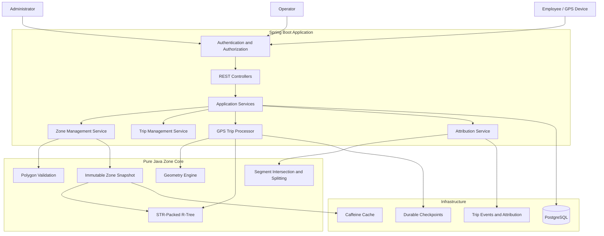
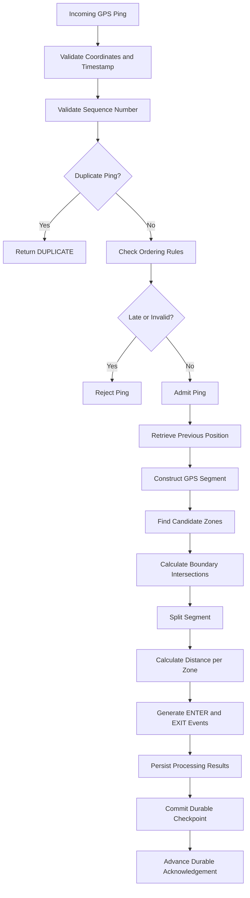
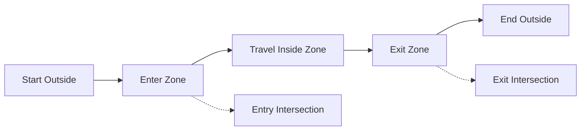
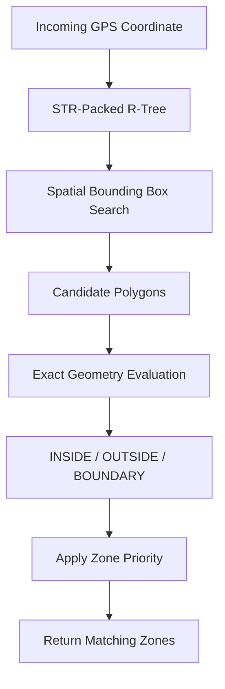
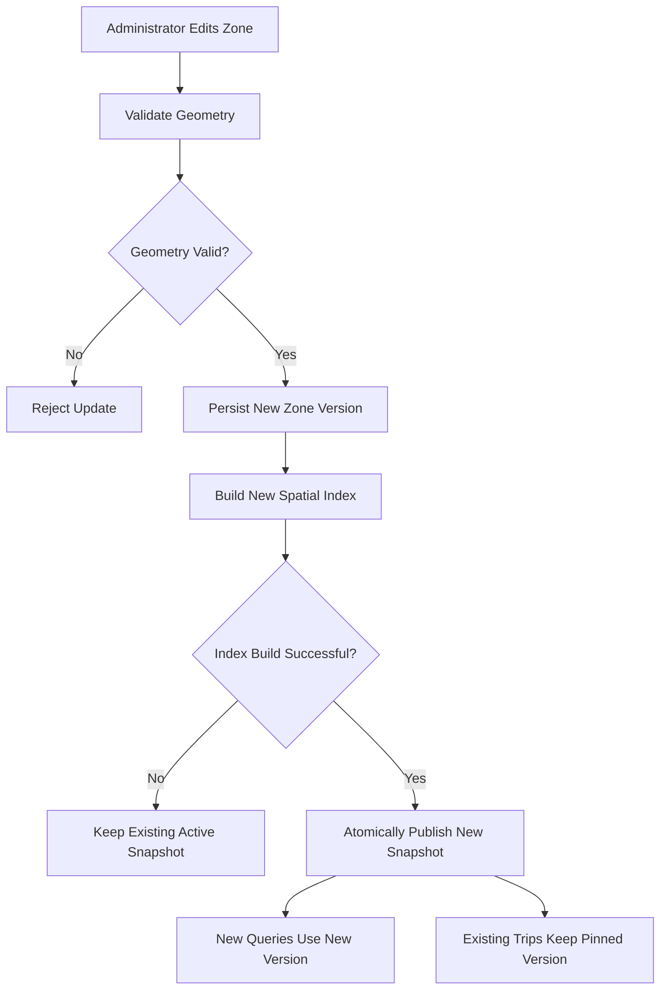
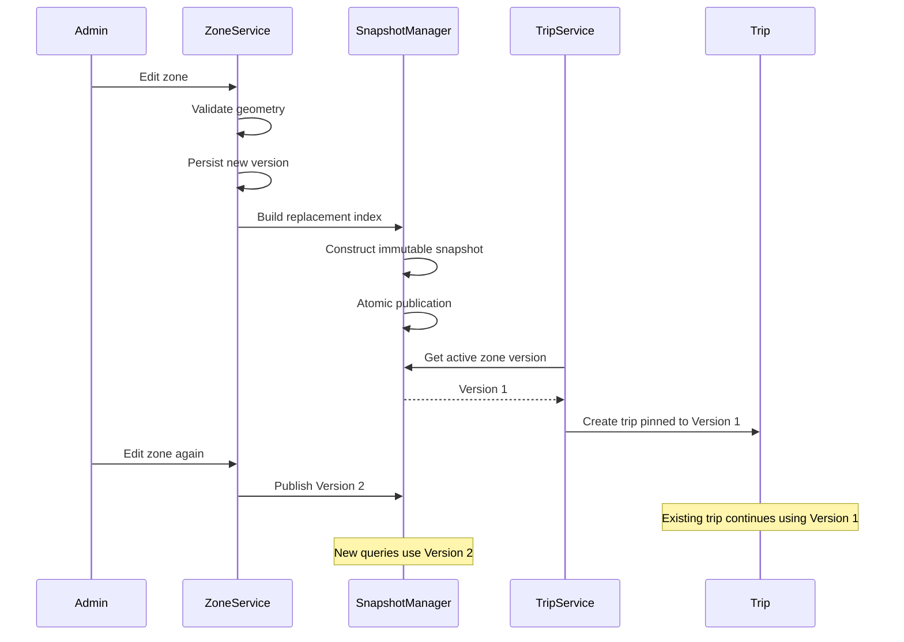
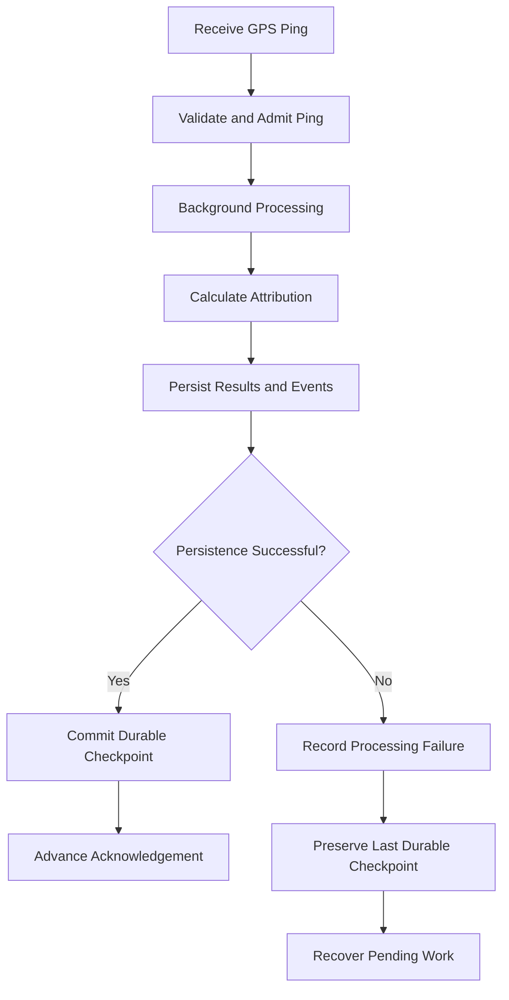
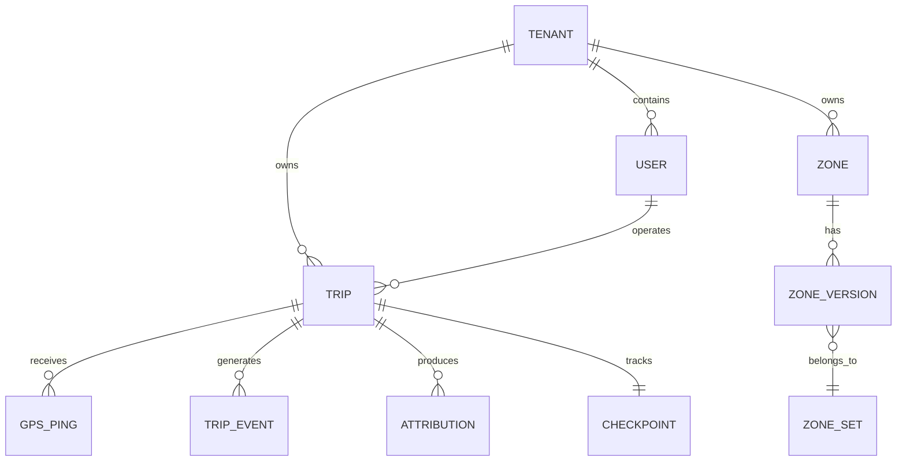
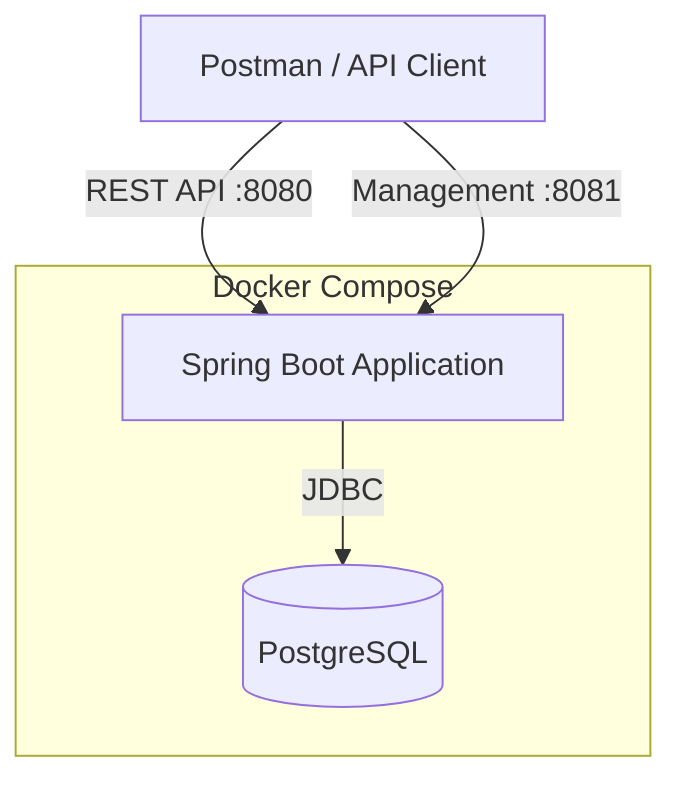

# Polygon Zones at Scale
### Tariff Zones, No-Go Areas & Trip Attribution

A versioned geographic zone engine for mobility platforms: admins draw zones, live GPS pings are matched against them, every trip's distance is split by zone for billing, and zones can be edited while the system runs.
[DEMO VIDEO](https://drive.google.com/file/d/1lWHi95041xhhwSutoFXjsN-U0tB8xDlV/view?usp=sharing).
## What it does

- **Zone management:** non-convex polygons with holes; unclosed rings, self-intersections and holes outside the outer ring are rejected. Every edit creates a new immutable version; old versions stay queryable.
- **Fast point queries:** an immutable STR-packed R-tree finds candidate polygons, then exact point-in-polygon decides (`INSIDE`, `OUTSIDE`, `BOUNDARY`).
- **Trip attribution:** GPS segments are split exactly where they cross zone boundaries; distance is attributed per zone; ENTER/EXIT events are generated with dwell time; entering a NO_GO zone during the night window raises an alert.
- **Live edits:** a new index is built in the background and published atomically; a trip keeps the zone-set version it started with.
- **Platform:** JWT auth with ADMIN / OPERATOR / EMPLOYEE roles, tenant isolation, durable checkpoints, Caffeine caching, Micrometer metrics, structured errors, Docker Compose.

The geometry and index live in `zone-core`, a plain Java module with no Spring, database or HTTP dependency.

## Architecture



## Quick start

Requires Docker with Compose (Java 25 only if you build outside Docker).

```bash
git clone https://github.com/masterhj/Polygon-Zones-at-Scale-Assignment.git
cd Polygon-Zones-at-Scale-Assignment
docker compose up --build                  # app + PostgreSQL, one command
curl http://localhost:8081/actuator/health # {"status":"UP"}
./scripts/demo.sh                          # automated end-to-end demo (second terminal)
docker compose down -v                     # stop and delete the local database
```

Ports: REST API `8080`, management/health `8081`. The `demo` profile seeds tenants `acme` and `globex`, users `admin`, `operator`, `employee` (password `DemoOnly-ChangeMe-2026`, demo only) and Bengaluru zones (city, airport with an apron hole, tariff, night no-go). Step-by-step walkthrough: [docs/DEMO-GUIDE.md](docs/DEMO-GUIDE.md).

## API tour

All endpoints are under `/api/v1`; send the JWT as `Authorization: Bearer <token>`.

| Method | Endpoint | Role | Purpose |
|---|---|---|---|
| POST | `/auth/login` | public | Get a JWT (`tenant`, `username`, `password`) |
| POST | `/zones/validate` | ADMIN | Validate polygon geometry |
| POST | `/zones` | ADMIN | Create a zone (new zone-set version) |
| POST | `/zones/query` | ADMIN, OPERATOR | Which zones contain this point? |
| POST | `/trips` | OPERATOR | Start a trip (pins the current zone-set version) |
| POST | `/trips/{id}/pings` | OPERATOR | Submit GPS pings |
| POST | `/trips/{id}/complete` | OPERATOR | Complete a trip |
| GET | `/trips/{id}/attribution` | OPERATOR, EMPLOYEE (own) | Distance per zone |
| GET | `/trips/{id}/events` | OPERATOR, EMPLOYEE (own) | ENTER / EXIT events |

```bash
# Which zones contain this point?
curl -X POST http://localhost:8080/api/v1/zones/query \
  -H "Authorization: Bearer $TOKEN" -H "Content-Type: application/json" \
  -d '{"lon":77.55,"lat":12.93}'
# -> {"setVersion":1,"zones":[{"name":"AIRPORT","priority":20,"location":"BOUNDARY"},
#                             {"name":"CITY","priority":10,"location":"INSIDE"}]}

# Start a trip, send pings (the repeated seq 1 comes back DUPLICATE), complete, read attribution
curl -X POST http://localhost:8080/api/v1/trips -H "Authorization: Bearer $OPERATOR_TOKEN" \
  -H "Content-Type: application/json" \
  -d '{"employeeId":"<employee-uuid>","startTime":"2026-10-31T11:00:00Z"}'
curl -X POST http://localhost:8080/api/v1/trips/$TRIP_ID/pings -H "Authorization: Bearer $OPERATOR_TOKEN" \
  -H "Content-Type: application/json" \
  -d '{"pings":[{"seq":0,"eventTime":"2026-10-31T11:00:05Z","lon":77.42,"lat":12.82,"accuracyMeters":5.0},
                {"seq":1,"eventTime":"2026-10-31T11:05:00Z","lon":77.56,"lat":12.93,"accuracyMeters":5.0}]}'
curl -X POST http://localhost:8080/api/v1/trips/$TRIP_ID/complete -H "Authorization: Bearer $OPERATOR_TOKEN"
curl http://localhost:8080/api/v1/trips/$TRIP_ID/attribution -H "Authorization: Bearer $OPERATOR_TOKEN"
```

Demo result (`HAVERSINE_SEGMENT_SPLIT`): City 16.707 km + Airport 2.784 km = 19.491 km. A Globex operator requesting an Acme trip gets `404 TRIP_NOT_FOUND`. Ping timestamps must pass the clock-skew check.

## Trip processing



Segment splitting: each segment between pings is cut exactly where it crosses a zone boundary, and each piece is classified on its own.



## Rules and assumptions

| Topic | Rule |
|---|---|
| Boundary | A point on an edge or vertex is classified `BOUNDARY` and counts as **inside** the zone. A point inside a hole is outside. |
| Tolerance | Boundary epsilon `1e-9` degrees; segment-parameter epsilon `1e-12`. |
| Distance | Haversine great-circle distance. Containment and segment intersection use planar lon/lat, with interpolation between pings assumed straight. |
| Distance error | On 36 test coordinates: max Haversine relative error **0.561 %**, max degree-interpolation midpoint deviation **383.9 m** (`docs/benchmarks/distance-error.csv`). Specific to that test set, not a universal bound. |
| Overlapping zones | All containing zones are returned, ordered by `priority`. |
| Versioning | Every successful edit creates a new immutable zone-set version; old versions stay readable. |
| In-progress trips | A trip is **pinned** to the zone-set version active when it started and keeps it until completion. New trips and new queries use the latest version. |
| No-go alerts | Entering a NO_GO zone during the night window raises an alert. |
| Pings | Each ping has `tripId`, `seq`, `lat`, `lon`, event time. Duplicates are ignored (`DUPLICATE`); late, invalid-coordinate and clock-skewed pings are rejected. |
| Acknowledgement | An accepted ping is not yet durably processed; the durable acknowledgement advances only after results and checkpoint are committed. |

## Frontend View of Employee


## Frontend View of Admin


## Spatial index and complexity

An immutable **STR-packed R-tree** over polygon bounding boxes. Zone edits are rare and queries are constant, so rebuilding a whole read-only tree is simple to prove correct, packs well and is trivially safe to share across threads; a grid or geohash struggles when zone sizes differ greatly (city vs. terminal apron).



- **Query:** brute force is `O(N × V)`; with the index it is `O(log N + K × V)` (`N` polygons, `V` average vertices, `K` candidates from the tree).
- **Memory:** linear in total vertices (table below).
- **Where it stops scaling:** `K` grows when many large or heavily overlapping zones cover the same area, so cost depends on spatial distribution; a very large polygon is a candidate for many points; a full rebuild per edit costs time and temporary memory as the data grows; the deployment is single-instance.

## Live edits

1. Validate geometry. 2. Persist the new zone version. 3. Build a complete replacement index in the background. 4. Publish it with one atomic swap. 5. New queries use it; running trips keep their pinned snapshot.





If the build fails, the previous snapshot keeps serving. Readers never see a half-built index. A concurrency test runs 16 reader threads against 200 rebuild-and-publish cycles: zero torn snapshots, zero version regressions.
## DATABASE Schema

you can access through this [Link](https://drive.google.com/file/d/1S7lgu43K-9cTAdTG9EcJNvTNIqo_KFYq/view?usp=sharing)

## Reliability

| Failure | Handling |
|---|---|
| Duplicate / late / out-of-order / invalid / clock-skewed ping | Detected by sequence and timestamp checks; duplicates not reprocessed, others rejected with a reason |
| Worker or database failure | Last durable checkpoint is preserved; uncommitted work is not acknowledged; pending work is recovered |
| Index rebuild failure | Previous snapshot stays active |
| Cache eviction of an old snapshot | Immutable version is reloaded on demand; snapshots pinned by active trips are never evicted |
| Cross-tenant request | Non-disclosing `404` |
| Lock loss | Single-instance deployment: a PostgreSQL advisory lock is held for the process lifetime; on loss the app goes unready, stops work and terminates (no distributed fencing) |



Full table and sequence diagram: [docs/design-note.md](docs/design-note.md).

## Security and tenancy

JWT (HS256) with `sub`, `tid` and roles, no personal data in the token. Roles: **ADMIN** (zones, system), **OPERATOR** (trips and pings), **EMPLOYEE** (own trips). Tenant comes only from the token; every query is tenant-scoped, and cross-tenant access returns `404`. Login throttling: 5 failures per 5 minutes, then `429`. Errors use RFC 9457 problem details; logs and error bodies contain no phone, email or home location.

## Monitoring and caching

Prometheus metrics (management port): `ping_processing_lag_seconds`, `ping_worker_failure_total`, `checkpoint_failures_total`, `ping_rejected_total{reason=late|invalid|clock_skew}`, `retry_total`, `ping_queue_depth`; plus health and standard JVM/HTTP metrics.


| Cache | Policy | What can be stale |
|---|---|---|
| Historical zone snapshots | Caffeine W-TinyLFU, weighted by vertex count (default budget 5,000,000 vertices), key = tenant + zone-set version | **Nothing.** Versions are immutable. |
| Active trip snapshots | Held outside the cache while the trip is active | Nothing; pinned by design |
| Latest zone set | In-memory atomic reference, swapped only after the database commit | Nothing on this instance after the swap; readers see the complete old or complete new version |
| Login throttle | Expire after 5 minutes idle, max 100,000 entries | Counters only |

## Benchmarks

Machine: Apple M2, 8 cores, 16 GB RAM, macOS 26.5.1, OpenJDK 25.0.2. Method and raw data: `docs/benchmarks/`.

| Measurement | Result |
|---|---|
| Point-query throughput, 16-vertex polygons | 8,091,255 queries/s |
| Point-query throughput, 500-vertex polygons | 2,923,697 queries/s |
| Index build time | 2.679 ms |
| Query allocation (`forEachContaining`) | 0.00077 B/op (list-returning API: about 98.6 B/op) |

| Retained heap | |
|---|---:|
| 1,000 × 16 vertices | 1.64 MB |
| 5,000 × 16 vertices | 6.94 MB |
| 20,000 × 16 vertices | 23.29 MB |
| 100,000 × 16 vertices | 116.90 MB |
| 5,000 × 500 vertices | 115.38 MB |

**Scope:** these are in-process index measurements. They are not HTTP, database, durable-ingestion or end-to-end figures, and they are not a claim of production capacity at 50,000 pings/s.

## Tests

`./mvnw verify` runs everything (Docker needed for Testcontainers). At the last run: 62 core tests, 58 service unit/slice tests, 13 PostgreSQL integration tests, **133 passed, 0 failed, 0 skipped**. Coverage includes polygon validation, non-convex shapes, holes, edge and vertex cases, segment splitting, index vs. a naive oracle, concurrent snapshot swaps, versioning, trip attribution, duplicate/late ping handling, checkpoints, JWT and roles, tenant isolation, and failure recovery.

## Trade-offs and what was left out

- **Consistency over availability for billing:** a trip uses one pinned zone-set version, so an active trip does not adopt newly published boundaries.
- **Latency over freshness for queries:** the latest published snapshot is served; a new version appears after the atomic swap, not during the build.
- **Durability over speed:** acknowledgements advance only after the database commit.
- **Single instance:** simpler and consistent, but no horizontal scaling or distributed fencing.
- **Custom geometry instead of PostGIS:** keeps queries off the database and the core testable; approximation limits are listed above.
- **Memory for speed:** the whole index is held in memory, and a rebuild needs temporary extra memory.
- **Left out:** message broker ingestion, end-to-end load test at 50,000 pings/s, polygon simplification, distributed cache invalidation, dashboards and alerting.

## Documentation and layout

[docs/design-note.md](docs/design-note.md) (architecture, sequence diagram, failure modes) · [docs/tradeoffs.md](docs/tradeoffs.md) · [docs/DEMO-GUIDE.md](docs/DEMO-GUIDE.md) · [docs/DECISIONS-DEVIATIONS.md](docs/DECISIONS-DEVIATIONS.md) · [docs/benchmarks/](docs/benchmarks/)

Data model:



Deployment:



```text
zone-core/     pure Java geometry, validation, R-tree, segment splitting
zone-service/  Spring Boot app, REST, security, persistence, Flyway migrations
zone-bench/    JMH benchmarks
docs/  scripts/  Dockerfile  docker-compose.yml  pom.xml
```
