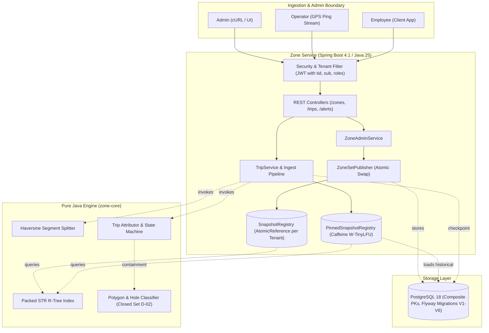
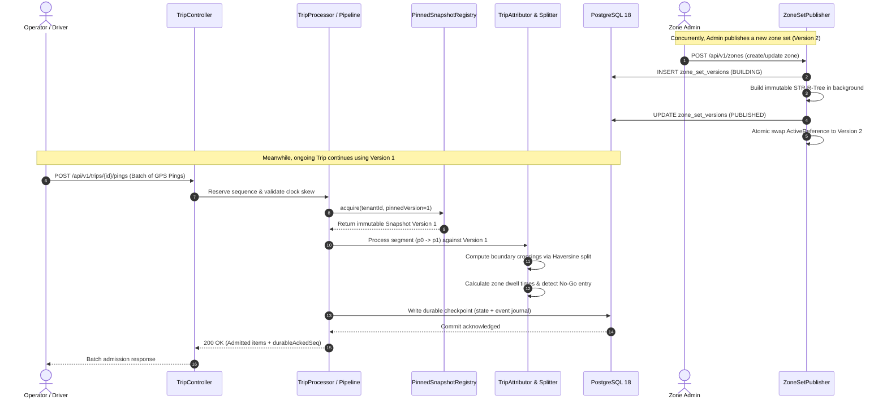

# Design Note — Polygon Zones at Scale

**Project:** MoveInSync Backend Case Study 2026 (Case Study 7 — Advanced Track)  
**Architecture:** Single Active Replica, Core Pure Java Layering, PostgreSQL 18 with Flyway, Java 25 LTS  

---

## 1. System Architecture

### Architectural Guiding Principles
1. **Framework-Free Core:** `zone-core` contains zero dependencies on Spring, Hibernate, Jackson, or Docker. It is 100% testable in pure Java.
2. **Hard Multi-Tenancy:** The tenant identity originates solely from the verified JWT `tid` claim. No request path or body accepts a tenant parameter. Database primary keys and unique indexes are composite with `tenant_id`.
3. **Single Active Writer Instance (D-20):** Designed and deployed as one active service instance per database, eliminating cross-instance cache tearing while achieving millions of queries per second in-process.

---

## 2. Sequence Diagram: Live Trip Ping Ingestion, Attribution & Concurrent Edit

---

## 3. Failure-Mode Table

| Failure Mode | Root Cause / Trigger | User / Client Visible Behavior | System Recovery & Mitigation |
|---|---|---|---|
| **Duplicate GPS Ping** | Mobile client retry or network packet retransmission | Synchronously returns `"status": "DUPLICATE"` in batch response item; no error raised. | Tracked in-memory via `BitSet`/frontier and committed to database checkpoints; idempotent discard. |
| **Out-of-Order Ping** | Cellular packet reordering or delayed delivery | Buffered up to hold-window; processed in strict sequence order once missing ping arrives. | `ReorderBuffer` holds out-of-order pings up to 2 seconds / 64 pings before advancing frontier with late marking. |
| **Late Ping (Past Frontier)** | Mobile ping arriving after gap timeout has forced frontier advance | Returns `"status": "REJECTED", "reason": "LATE"`. | Rejected from sequence frontier to prevent retroactively rewriting billing history. |
| **Transient Database Outage** | PostgreSQL temporary connection drop / restart | Point queries continue serving from in-memory R-Tree. Pings buffer in memory; durable ACK pauses. | Backpressure guard rejects overload at 10,000 pings (`429 BACKPRESSURE`). Checkpoint retry loop flushes backlog once DB reconnects. |
| **Service Crash / Restart** | Host reboot or process kill | In-flight HTTP request drops. | On startup, `StartupSnapshotLoader` warms active zone snapshots; `TripExecutionRegistry` restores active trips from last durable checkpoint. |
| **Publish Validation Failure** | Admin submits self-intersecting or unclosed polygon | Returns RFC 9457 `400 Bad Request` with problem code `VALIDATION_FAILED`. | Transaction rolls back; active published snapshot remains untouched and serving queries. |
| **Cross-Tenant Access Attempt** | Malicious or buggy client requesting another tenant's ID | Returns RFC 9457 `404 Not Found` (never 403). | Strict tenant isolation prevents foreign tenant ID existence leaks. |
